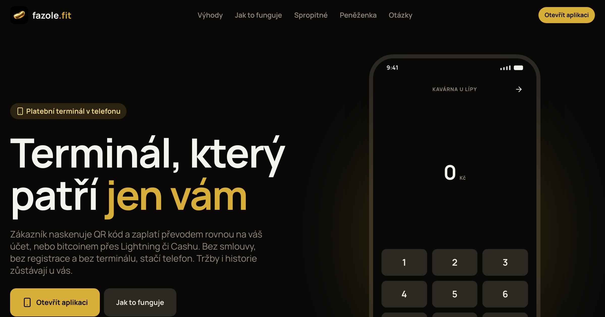

# Linky

A Bun monorepo for local-first Bitcoin apps on Nostr, Cashu and Evolu: the Linky and Fazole apps, their websites and services, and the TypeScript packages they share. Data lives in Evolu (SQLite) on the device and syncs between devices through an Evolu relay; Users talk to each other using Nostr. Wallets talk to Cashu mints directly. Some packages publish to npm for anyone to use.

## Linky

[](https://github.com/linky-fit/linky/releases/latest)
[](https://app.linky.fit)
[](https://github.com/linky-fit/linky/deployments/Production%20%E2%80%93%20linky-website)
[](https://github.com/linky-fit/linky/deployments/push)

[](https://linky.fit)

A mobile-first PWA for contacts, private Nostr messaging and Lightning/Cashu payments. It runs in the browser, on Android and as a macOS desktop app.

[Download](https://linky.fit) Linky!

### Public sites

- [linky.fit](https://linky.fit): the website
- [app.linky.fit](https://app.linky.fit): the app
- [nightly.app.linky.fit](https://nightly.app.linky.fit): the app built from `main`, ahead of the last release
- [Google Play](https://play.google.com/store/apps/details?id=fit.linky.app) and [Zapstore](https://zapstore.dev/apps/fit.linky.app): the Android app

### Code

- [`apps/linky-app`](./apps/linky-app/): the PWA; changes in [`CHANGELOG.md`](./apps/linky-app/CHANGELOG.md)
- [`apps/linky-site`](./apps/linky-site/): the website `linky.fit`
- [`apps/native-shell`](./apps/native-shell/README.md): Android and iOS builds, signing, push setup
- [`apps/desktop`](./apps/desktop/README.md): macOS desktop shell
- [`apps/push`](./apps/push/README.md): Web Push and FCM service at `push.linky.fit`
- [`apps/onchain-operator`](./apps/onchain-operator/README.md): the on-chain operator's console for on-chain transfers, deployed by hand to operator.twoballers.dev

## Fazole

[](https://github.com/linky-fit/linky/releases?q=fazole-v)
[](https://app.fazole.fit)
[](https://github.com/linky-fit/linky/deployments/Production%20%E2%80%93%20fazole-site)

[](https://fazole.fit)

A payment terminal PWA for Czech merchants: bank transfers (SPD QR), Lightning and Cashu. It runs on Linky's packages and shares Linky accounts, but ships on its own version and release.

### Public sites

- [fazole.fit](https://fazole.fit): the website
- [app.fazole.fit](https://app.fazole.fit): the app
- [nightly.app.fazole.fit](https://nightly.app.fazole.fit): the app built from `main`, ahead of the last release

### Code

- [`apps/fazole-app`](./apps/fazole-app/README.md): the PWA at `app.fazole.fit`; changes in [`CHANGELOG.md`](./apps/fazole-app/CHANGELOG.md)
- [`apps/fazole-site`](./apps/fazole-site/): the website `fazole.fit`

[`docs/releases.md`](./docs/releases.md) covers how each Linky and Fazole target ships.

## Published packages

[](https://github.com/linky-fit/linky/deployments/npm)

We also publish npm packages, to make it easier for other developers to work with tools we use. Those packages are in very early stage of it's development so please, use with caution. The three libraries share one SemVer version and publish together; see [`docs/npm-releases.md`](./docs/npm-releases.md).

- [](https://www.npmjs.com/package/@linky-fit/linkstr) [`packages/linkstr`](./packages/linkstr/README.md): typed Nostr messaging, profiles and relay services, built on Effect
- [](https://www.npmjs.com/package/@linky-fit/linkshu) [`packages/linkshu`](./packages/linkshu/README.md): typed Cashu wallet services with pluggable storage, built on Effect
- [](https://www.npmjs.com/package/@linky-fit/linkauth) [`packages/linkauth`](./packages/linkauth/README.md): log in with a Nostr key, with origin-bound assertions for servers and browsers

## Internal packages

- [`packages/linksync`](./packages/linksync/README.md): synced storage (Evolu schema, repositories, shards); guides in [`docs/`](./packages/linksync/docs/)
- [`packages/linkstr-react`](./packages/linkstr-react/): React bindings for linkstr; guide in [`linkstr/docs/react.md`](./packages/linkstr/docs/react.md)
- [`packages/proxy-payment`](./packages/proxy-payment/README.md): proxy bank payments (bank QR parsing, offer rules); guides in [`docs/`](./packages/proxy-payment/docs/)
- [`packages/recurring-payment`](./packages/recurring-payment/README.md): recurring payments (schedule math, the planner, claims between devices); guides in [`docs/`](./packages/recurring-payment/docs/)
- [`packages/keryx`](./packages/keryx/README.md): Keryx client (join URLs, pairing, TUF and item verification for company announcements); guide in [`docs/keryx.md`](./packages/keryx/docs/keryx.md)
- [`packages/ui`](./packages/ui/README.md): Tamagui design system for Expo and the web; catalog in [`apps/ui-book`](./apps/ui-book/README.md)
- [`packages/domain`](./packages/domain/README.md): the branded ids every package and app share
- [`packages/identity`](./packages/identity/): key derivation (SLIP-39, Nostr, LNURL auth)
- [`packages/config`](./packages/config/): shared ESLint, Prettier, tsconfig and npm packaging

Tools: [`apps/linkshu-cli`](./apps/linkshu-cli/README.md) (terminal Cashu wallet), [`tools/nostr-error-tracker`](./tools/nostr-error-tracker/README.md) (error dashboard), [`docker/evolu-relay`](./docker/evolu-relay/README.md) (relay image and per-owner quota).

## Development

Requirements: Bun and Docker (local Nostr relay, Evolu relay and FakeWallet Cashu mint). Android builds need Java 17.

```bash
bun install
bun run dev           # Docker stack, Linky app on :5173, push service on :8787
bun run fazole:dev    # Fazole app on :5280; needs the Docker stack `bun run dev` starts
bun run onchain-operator:dev  # on-chain operator console on :5295; also needs `bun run bitcoin:up`
bun run test          # unit tests in every workspace
bun run check-code    # typecheck, eslint --fix, prettier --write
bun run test-changed  # unit tests in the workspaces this branch reaches
bun run check-changed # check-code in the workspaces this branch reaches
```

Bitcoin regtest for on-chain transfers (Docker profile `bitcoin`, not started by `bun run dev` or the e2e stack): bitcoind RPC on `localhost:18443` (`linky`/`linky`), Esplora API on http://localhost:3002, block explorer on http://localhost:3003.

```bash
bun run bitcoin:up                            # start bitcoind, electrs and the explorer
bun run bitcoin -- init                       # create the funded `dev` wallet (101 blocks)
bun run bitcoin -- send <address> <btc>       # pay from `dev`, prints the txid
bun run bitcoin -- mine <n> [address]         # mine blocks, waits until Esplora indexed them
bun run bitcoin -- balance                    # also: newaddress [type], cli <bitcoin-cli args...>
bun run bitcoin -- import-descriptor <wallet> <descriptor>  # e.g. the dev operator's BIP86 tprv
bun run bitcoin:down                          # stop it; chain and wallets stay in Docker volumes
```

End-to-end tests (Playwright against a Docker stack owned by the checkout, so worktrees can run them side by side):

```bash
bun run e2e          # linky-app suite; extra args go to Playwright
bun run e2e site     # linky-site suite
bun run e2e down     # stop the stack and drop its data
```

[`AGENTS.md`](./AGENTS.md) lists the invariants and conventions; [`GLOSSARY.md`](./GLOSSARY.md) defines the domain terms.

## Contributing

See [`CONTRIBUTING.md`](./CONTRIBUTING.md).

## License

Zero-Clause BSD (`0BSD`), see [`LICENSE`](./LICENSE).
